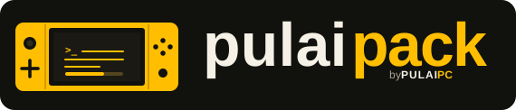

# pulaipack

Public release assets for the pulaipack AIO-Switch-Updater custom pack.
AIO downloads the latest release from:

`https://github.com/pulaipc/pulaipack-downloads/releases/latest/download/pulaipack.zip`

Keep the asset name `pulaipack.zip` unchanged for every release. Release assets are built
from the separate pulaipack source project.

`pulaipack.zip` is the ready-to-copy pack for the Nintendo Switch SD card. This inventory
describes the selected pack setup. For the exact component versions in a particular ZIP,
see `PACK-MANIFEST.txt` inside it. You can also update the pack directly on the console
using AIO-Switch-Updater.

## What's included

### Boot and Atmosphere

- Atmosphere CFW, its `fusee` payload, and the official Hekate bootloader
- Base Atmosphere configuration and sigpatches
- A two-entry Hekate launch menu (OFW and Atmosphere on emuMMC)
- Custom boot logo, matching Nyx colours, and launch-entry icons
- Sphaira set as the homebrew menu

### Homebrew apps and utilities

- DBI, Sphaira, Tinwoo, CyberFoil, and pipensx
- JKSV, Goldleaf, Linkalho, and NX Activity Log
- NXThemesInstaller, Themezer-NX, and the 90DNS Tester
- AIO-Switch-Updater and Breeze

### Overlays and system tools

- Tesla/Ultrahand, the Sysmodules overlay, Status Monitor, FPSLocker, and EdiZon
- emuiibo, ldn_mitm, and QuickNTP
- MissionControl, sys-clk, sys-patch, SaltyNX, and nx-ovlloader
- Disable Remap Dialog and theme-patches
- FuseCheck, KitNX, Lockpick_RCM_Pro, ProdinForge, TegraExplorer-Ext, and
  Warmboot-Extractor payloads

### Privacy and configuration

- 90DNS hosts files
- PRODINFO-blanking configuration
- SaltyNX is included but starts disabled; the pack includes its Ultrahand toggle

## Updating before a firmware update

When Nintendo releases new system firmware, update the pack first—but only after a pulaipack
release is available that supports that firmware.

1. Check the latest pulaipack release notes and confirm your target firmware is listed
   under **Firmware compatibility**. If it is not listed, wait for a compatible release.
2. While the console is still on its current firmware, use AIO-Switch-Updater's
   **[PACK] pulaipack** entry to install the matching pack release. Alternatively, download
   `pulaipack.zip` and extract it to the SD card root.
3. After updating the pack, update the console's system firmware.

The ZIP is assembled from the checked component setup; it is not a bundled base image.
The component manifest inside the archive records the versions used for this build.
